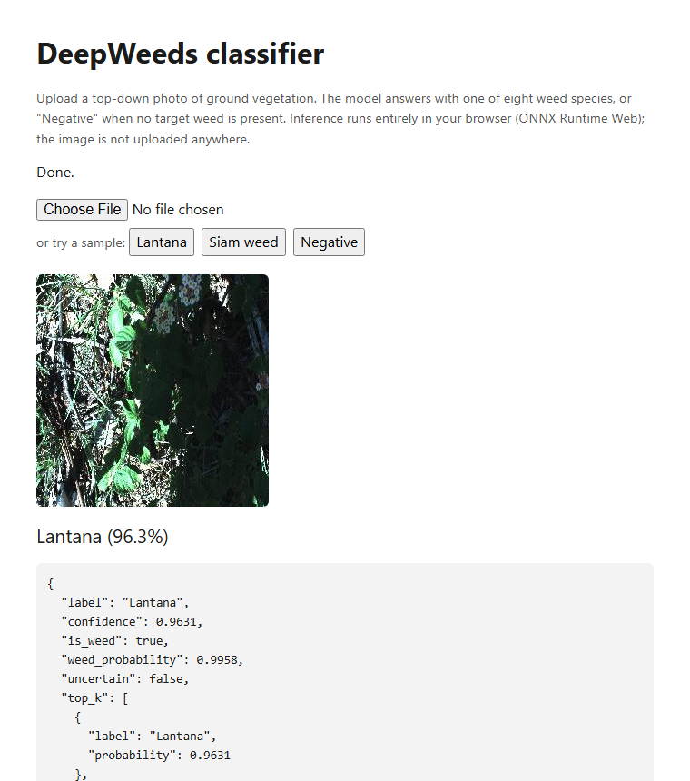
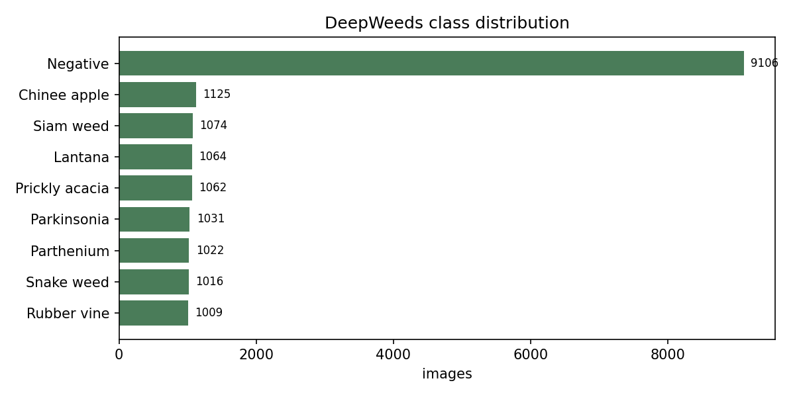
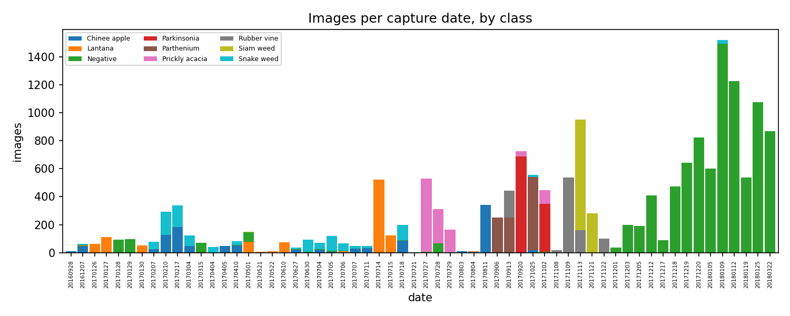
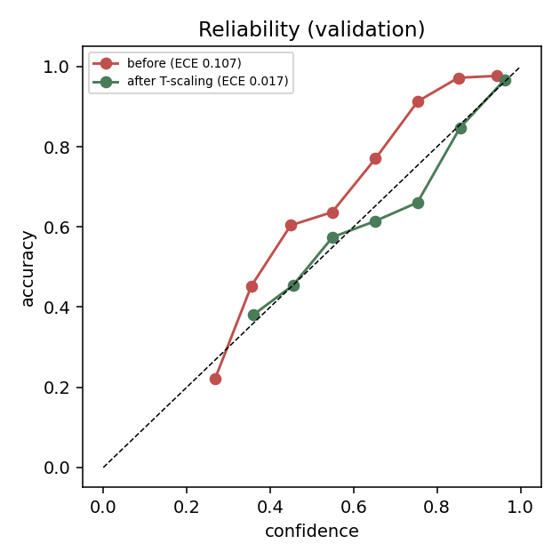
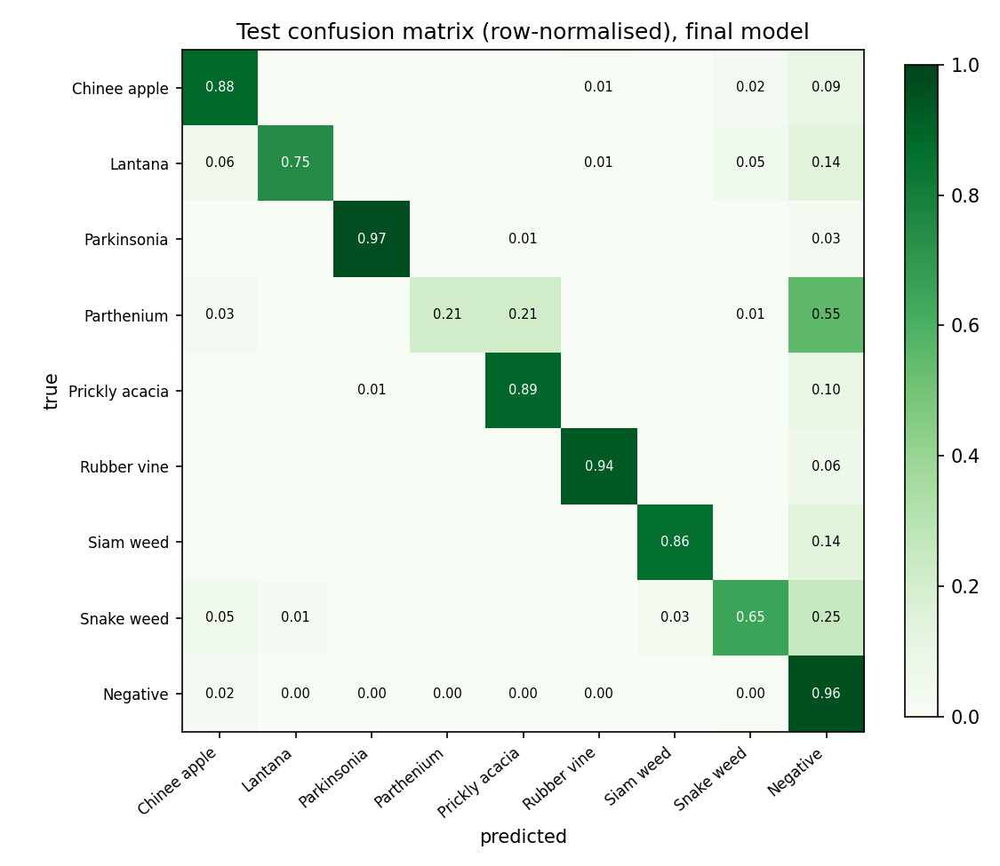
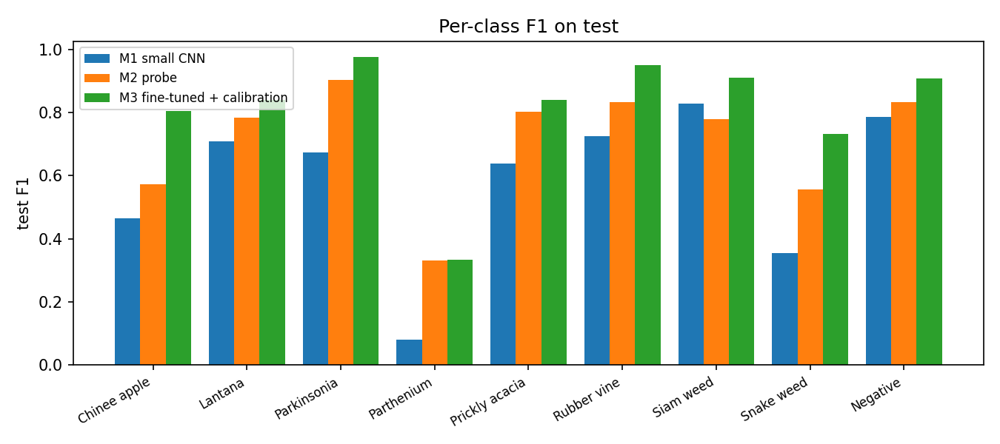

# DeepWeeds weed classifier

[](https://github.com/haroonwaheed19/deepweeds-classifier/actions/workflows/ci.yml)

Image classification of field photos into eight weed species or "Negative" (no target weed), built for the
SparkAI ML engineering assessment. Everything was trained on a 2-core laptop CPU (i3-1005G1, 7.7 GB RAM, no GPU).

**Live demo:** https://haroonwaheed19-deepweeds-classifier.static.hf.space
(Space page: https://huggingface.co/spaces/haroonwaheed19/deepweeds-classifier)



> **How the live endpoint works, and what it is not.** Hugging Face now charges for Docker and Gradio Spaces
> (I got a `402 Payment Required` creating one), and I did not want to move off Hugging Face or pay. The only
> free Space type is static, which has no server. So the live app is a static page that runs the trained ONNX
> model **in your browser** with ONNX Runtime Web: upload a photo or click a sample and the prediction happens
> locally. That meets the "simple web interface for image upload and prediction" option in the brief, but it is **not a hosted
> REST API**. The REST service (FastAPI + Docker) is in this repo, is built and smoke-tested by CI, and runs
> anywhere Docker runs; see [Inference and deployment](#7-inference-and-deployment).

## Contents

- [TL;DR](#tldr)
- [1. Problem and dataset choice](#1-problem-and-dataset-choice)
- [2. Data understanding](#2-data-understanding)
- [3. Splits, preprocessing, imbalance](#3-splits-preprocessing-imbalance)
- [4. Models and compute awareness](#4-models-and-compute-awareness)
- [5. Results](#5-results)
- [6. Error analysis](#6-error-analysis)
- [7. Inference and deployment](#7-inference-and-deployment)
- [8. Repository layout and engineering notes](#8-repository-layout-and-engineering-notes)
- [9. Reproduce](#9-reproduce)
- [10. What I would do with more compute](#10-what-i-would-do-with-more-compute)
- [11. Limitations and things I got wrong](#11-limitations-and-things-i-got-wrong)

## TL;DR

Held-out test set: 2,627 images from 32 capture sessions. Brackets are 95% confidence intervals from a
bootstrap that resamples whole capture groups (frames from one session are near-copies, so resampling single
images would give intervals that are too tight).

| model | test macro-F1 | accuracy | weeds found | false alarms |
|---|---|---|---|---|
| M0: always predict "Negative" | 0.076 [0.029, 0.105] | 0.522 | 0% | 0% |
| M1: small CNN from scratch | 0.584 [0.418, 0.661] | 0.670 | 85.0% | 26.3% |
| M2: frozen EfficientNet-B0 features + logistic regression | 0.710 [0.564, 0.764] | 0.773 | 75.5% | 12.6% |
| **M3: fine-tuned MobileNetV3-Large (shipped)** | **0.811 [0.659, 0.880]** | 0.869 | 83.0% | 3.8% |

"Weeds found" is recall of the weed-vs-Negative decision; "false alarms" is the share of Negative images called a weed.

Three things I would want a reviewer to take from this:

1. **A random split overstates performance by about 10 macro-F1 points.** Most capture sessions contain only one to three
   classes, so a random split lets a model score by recognising the session. The same linear probe scores 0.806 on the
   dataset paper's random split and 0.706 on my session-grouped split.
2. **The dominant failure is session shift, not model capacity.** Species recall on the test set is 0.89 when the
   class was photographed on that date in the training data and 0.51 when it was not. Parthenium, whose whole test
   session is a day the model never saw, gets 21% recall.
3. **Fine-tuning earns its cost, calibration does not earn accuracy.** M3 beats the frozen-feature probe by
   +0.103 macro-F1 (paired CI 0.051 to 0.162). The temperature scaling and Negative-bias I added on top changed
   macro-F1 by -0.002 (CI -0.031 to +0.035); they move the operating point (fewer false alarms, fewer weeds found), nothing more.

## 1. Problem and dataset choice

**Task:** image classification, nine classes. **Dataset:** [DeepWeeds](https://github.com/AlexOlsen/DeepWeeds)
(Olsen et al., *Scientific Reports* 2019, CC BY 4.0): 17,509 RGB photos, 256x256, of eight Australian weed species plus
a "Negative" class of other vegetation and ground, photographed from above at several sites in northern Australia
between September 2016 and March 2018.

Why this dataset, in order of how much it mattered:

- **It has the data problems the brief asks me to handle, for real.** 52% of images are one class; the photos come in
  bursts from 60 capture dates, so naive splitting leaks; species look alike; the weed is often a small part of a
  cluttered frame.
- **It maps to a real decision.** A spot-sprayer needs "is there a target weed here, and which one". A missed weed keeps
  spreading, a false alarm wastes herbicide. I report both rather than hiding them in one accuracy number.
- **It is small enough for a CPU.** 256x256 images, about 27 KB each, 17.5k in total. Not MNIST/CIFAR-10, not so big that
  I would need to subsample it.

Why classification and not detection or segmentation: the labels are image-level only. Producing boxes or masks
would mean annotating them myself, which would eat the time I wanted for evaluation and deployment.

## 2. Data understanding

`python -m weedcls.data.inspect` writes `reports/metrics/data_summary.json` and the figures below.

| | |
|---|---|
| Size | 17,509 images, all 256x256 RGB JPEG, mean 27.4 KB, none unreadable, no duplicate filenames |
| Label format | `labels.csv` with `Filename,Label,Species`; labels 0-7 are the weeds, 8 is Negative |
| Classes | Negative 9,106 (52.0%); each weed 1,009 to 1,125 |
| Capture | 60 dates from 2016-09-28 to 2018-03-22; filenames are `YYYYMMDD-HHMMSS-k.jpg` |



The imbalance ratio is 9.0x overall, but the eight weeds are balanced among themselves (1.1x). So the imbalance is
really "weed vs not weed", and it is what makes accuracy a poor headline metric: a model that always says "Negative"
gets 52.2% accuracy and macro-F1 0.076.

**Sessions are tangled up with class.** Most capture dates contain one to three classes, and some classes exist on very few dates:

| class | dates it appears on |
|---|---|
| Parkinsonia | 2 |
| Parthenium | 3 |
| Siam weed | 3 |
| Prickly acacia, Rubber vine | 6 each |
| Lantana | 14 |
| Snake weed | 20 |
| Chinee apple | 22 |
| Negative | 34 |



That one table drove most of my later decisions: it is why I do not use a random split, why a strict one-date-per-split
design is impossible for Parkinsonia, and (in section 6) why the largest error cluster looks the way it does.

**Things I checked that turned out to be non-issues.** I expected near-duplicate images to give me label-noise
evidence. Perceptual hashing (pHash, 64-bit) found 96 pairs at Hamming distance 4 or less: zero across classes, zero
across dates, so duplicates are harmless once whole sessions stay together. The filename suffix `-k` (0 to 4) is not
documented and is strongly class-correlated (85% of Snake weed has suffix 0, against 3.9% of Negatives), so I did not use
it as a feature.

**What the images look like** ([full grid](reports/figures/sample_grid.png)): the plant is often small, partial or
buried in clutter; there are heavy shadows and very dark frames; and some classes have a distinct colour cast
(Prickly acacia and Parthenium look blue-grey, Rubber vine bright green). That last point is a shortcut risk, and it
shows up again in the error analysis.

Dataset limitations I keep in mind: one region of one country, mostly one camera setup, 60 sessions, and "Negative" is a
catch-all rather than a defined class. A model that works here has not shown it works on another continent.

## 3. Splits, preprocessing, imbalance

### The split

I group images by capture session, defined as **(date, hour)** with near-duplicate pairs merged, giving 193 groups, and
assign whole groups to train/val/test. I tried the standard tool first (`StratifiedGroupKFold`, best of 300 seeds) and
rejected it: a few groups hold 500+ images, so folds were lumpy, and it left Parkinsonia with 16 test images and test at 11.6% of the data. With
only 193 groups I could do better by searching directly: hill-climbing on the squared deviation of every (split, class)
share from 70/15/15 (move/swap moves, 40 restarts), in `src/weedcls/data/splits.py`.

| | train | val | test |
|---|---|---|---|
| images | 12,280 (70.1%) | 2,602 (14.9%) | 2,627 (15.0%) |
| capture groups | 106 | 55 | 32 |
| every class's share of the split | 69.7 to 71.9% | 14.1 to 15.3% | 14.1 to 15.7% |

The split CSVs are committed (`data/splits/`), and `tests/test_splits.py` asserts no file or group overlap, full coverage
of all 17,509 images, and class shares within tolerance.

**Why (date, hour) and not whole dates:** Parkinsonia exists on only 2 dates, so whole-date holdout cannot put it in
three splits. The price is that my split is *weaker* than holding out days: 26 dates appear in both train and val and 17 in
train and test. For some classes the test therefore measures "same fields, different time of day"; for Parthenium the
search happened to put an entire unseen date in test. Section 6 uses both facts.

**The leakage measurement.** I also kept the dataset paper's random 60/20/20 split (`data/splits/official_*.csv`) purely as
a comparison. Same features, same model, same hyperparameters: macro-F1 0.806 on the random split, 0.706 on mine.

### Preprocessing and augmentation

- **Eval:** resize the whole 256x256 frame to the model's input size (no centre crop, because weeds can sit at the edge), normalise.
  Pretrained models use ImageNet statistics; the from-scratch CNN uses statistics computed on the train split only
  (mean 0.380/0.394/0.384, std 0.233/0.232/0.230, which is darker than ImageNet).
- **Train augmentation**, each tied to how the data was captured (`reports/figures/augmentation_examples.png`): flips and
  random 90 degree rotations (camera points straight down, so orientation means nothing), random resized crop with scale 0.7 to 1.0, colour jitter
  of 0.3 on brightness and contrast, 0.1 saturation, and almost no hue (0.02), because leaf colour is a species cue.
- **One implementation of eval preprocessing**, `src/weedcls/preprocess.py` (PIL + numpy, no torch), is used by training,
  evaluation, the ONNX service, and (re-implemented to match Pillow bit for bit) the browser app. See section 7.

### Imbalance

Class-weighted cross-entropy with inverse-square-root frequency weights, versus a `WeightedRandomSampler`, versus nothing, compared
on the small CNN (section 4). Weights and sampler tied on validation macro-F1 (0.362 vs 0.360); doing nothing was clearly
worse (0.27 to 0.30) because the model drifts to "Negative". I used weights since they do not resample the data.

### Label noise

I looked for it two ways instead of assuming it. First, cross-class near-duplicates (none). Second, out-of-fold
predictions of the linear probe on the training set, with folds grouped by session: 282 of 12,280 images (2.3%) have
a label the model contradicts with p > 0.9. I looked at the 40 most contradicted by eye: 7 look like real mislabels (a weed
label but no plant visible: a person's shadow, bare twigs), 13 look right and the model is wrong (often thrown by a colour cast), 20 are ambiguous.
That puts label noise at roughly 0.4% of training images or less (the sample is the worst-case end, not random), too small to
matter next to the session effect, so I removed and relabelled nothing.

## 4. Models and compute awareness

The brief says compute-awareness is judged, so the first thing I did was measure the machine
(`scripts/benchmark.py`, batch 32, 4 threads) instead of guessing:

| model | input | forward img/s | train img/s | params | est. minutes per training epoch |
|---|---|---|---|---|---|
| small CNN | 128 | 101.9 | 52.0 | 0.32M | 3.9 |
| MobileNetV3-Large | 224 | 58.0 | 13.1 | 5.48M | 15.6 |
| EfficientNet-B0 | 224 | 38.5 | 5.6 | 5.29M | 36.5 |
| ResNet-18 | 224 | 27.8 | 9.4 | 11.69M | 21.7 |

(Full table in `docs/decisions.md`.) Consequences I acted on: embedding all 17.5k images once is cheap (about 7 minutes
for MobileNetV3, 11 for EfficientNet-B0), so tuning a classifier on cached embeddings costs seconds per config.
EfficientNet-B0 at 36 minutes per epoch is out of reach for fine-tuning, though fine as a frozen feature extractor.

| | model | why it is there |
|---|---|---|
| M0 | always "Negative" | a floor, and the demonstration that accuracy misleads here |
| M1 | 0.32M-parameter CNN, 4 conv-BN-ReLU-pool blocks, 128px, trained from scratch | the "simple baseline" |
| M2 | frozen ImageNet backbone + logistic regression on cached embeddings | the cheapest possible test of whether transfer learning is justified |
| M3 | MobileNetV3-Large fine-tuned (last 8 of 17 blocks) | the model I ship |

### Is transfer learning justified? (validation numbers)

| | val macro-F1 | cost on this laptop |
|---|---|---|
| M1 scratch, 16 epochs | 0.558 | ~83 min |
| M2 frozen EfficientNet-B0 + LR | 0.706 | ~11 min embeddings + seconds |
| M3 fine-tuned MobileNetV3-L, 8 epochs | 0.801 | ~76 min |

Yes. Frozen features alone beat a network trained from scratch for about 80 minutes by 15 points: with about 1,000 images
per weed class, a scratch model has too little data to learn what a leaf looks like. Fine-tuning then adds another 9.5 points on
top of the frozen probe.

### Hyperparameter tuning (all on validation, never on test)

Tuning was deliberately cheap, on 30% of the training data and 3 to 4 epochs per run, to rank settings rather than
converge them (`reports/metrics/*_sweep.csv`).

- **Small CNN** (6 runs): learning rate {1e-3, 3e-3} x imbalance handling {weights, sampler, none}. Weights and sampler tied; "none" was clearly worse.
- **Linear probe** (24 fits, seconds each): backbone x regularisation C x class weighting. Best was EfficientNet-B0, C=0.003, no weights, 0.706. Class weighting
  *lowered* macro-F1 here (the probe already starts from strong features) but raised weed recall, a recall vs false-alarm trade I look at below.
  MobileNetV3 was 0.024 behind, which at 55 validation groups I treat as noise; I chose MobileNetV3 for fine-tuning on cost, not on that gap.
- **Fine-tuning** (5 runs): learning rate {3e-4, 1e-3} x number of unfrozen blocks {2, 4, 8}.

| head lr | trainable blocks | val macro-F1 |
|---|---|---|
| 1e-3 | **8** | **0.683** |
| 1e-3 | 4 | 0.662 |
| 1e-3 | 2 | 0.625 |
| 3e-4 | 4 | 0.620 |
| 3e-4 | 2 | 0.595 |

The best point of my first four runs was on the edge of the grid, so I added the 8-block run, which won again. I stopped
there because all-layer fine-tuning is about 16 minutes per epoch; deeper may well be better and I did not test it.

The final M3 run: 224px, label smoothing 0.1, weighted loss, head learning rate 1e-3 with the backbone at one tenth of that, epoch 0 trains the
head only, then the last 8 blocks unfreeze (4.09M of 4.21M parameters), cosine schedule, 8 epochs (about 76 minutes). Validation macro-F1 was still
climbing at the end (0.711, 0.759, 0.761, 0.770, 0.780, 0.795, 0.801 from epoch 1), so it is slightly under-trained.

### Calibration (fit on validation logits only)

- **Temperature** T = 0.72. Below 1, so the model is *under*-confident (label smoothing and class weights flatten the softmax). Expected calibration error 0.107 to 0.017.
- **Negative-logit bias** +1.8, added after dividing by T. Weighted training makes the model quick to call weeds; the bias moves that back. On validation it
  took macro-F1 0.801 to 0.816, false alarms 17% to 7.7%, weed recall 93% to 85%. (On test the macro-F1 gain did not hold; see section 5.)
- **"Uncertain" flag** below calibrated confidence 0.619, chosen so predictions above it are 90% accurate on validation; it flags about 10% of images.
  My first attempt used an 85% target and produced a threshold of 0.23 that flagged nothing, because overall accuracy already exceeds 85%.



## 5. Results

All test numbers use thresholds that were fixed on validation. Test is 2,627 images, 32 capture groups.

| model | macro-F1 [95% CI] | accuracy | balanced acc. | weeds found | false alarms | params | CPU ms/image |
|---|---|---|---|---|---|---|---|
| M0 majority | 0.076 [0.029, 0.105] | 0.522 | 0.111 | 0.0% | 0.0% | - | - |
| M1 small CNN | 0.584 [0.418, 0.661] | 0.670 | 0.616 | 85.0% | 26.3% | 0.32M | 10 (PyTorch, 128px, 4 threads) |
| M2 probe | 0.710 [0.564, 0.764] | 0.773 | 0.688 | 75.5% | 12.6% | frozen | - |
| M3 raw argmax | 0.815 [0.663, 0.881] | 0.863 | 0.827 | 90.4% | 9.4% | 4.21M | 23 PyTorch / 7 ONNX (forward only) |
| **M3 + T + bias (shipped)** | **0.811 [0.659, 0.880]** | 0.869 | 0.789 | 83.0% | 3.8% | 4.21M | 8.5 end to end |

Latency is one image on CPU. The M3 figures use 2 threads (`reports/metrics/latency.json`); the M1 figure was measured separately with 4 threads (`reports/metrics/test_results.json`). The ONNX file is 16.8 MB.

Paired comparisons (same bootstrap resamples for both models):

| comparison | macro-F1 difference [95% CI] |
|---|---|
| M3 shipped vs M2 probe | **+0.103 [0.051, 0.162]** |
| M3 shipped vs M1 scratch CNN | **+0.232 [0.157, 0.305]** |
| M3 shipped vs M3 raw (calibration only) | -0.002 [-0.031, +0.035] |

Reading these honestly:

- Fine-tuning's advantage is real (both intervals exclude zero). The calibration step is not an accuracy gain: the +0.015
  it showed on validation did not repeat on test. It is a change of operating point (false alarms 9.4% to 3.8%, weeds found 90.4% to 83.0%), and which end
  you want depends on whether a missed weed or a wasted spray costs more. The service returns `weed_probability` so a client can pick its own threshold.
- The interval on any single model is wide (M3: 0.66 to 0.88) because there are only 32 test groups and some classes live in one or two of them.
  Validation (0.816) and test (0.811) agree, which is reassuring, but I would not trust a ranking between two models closer than about 0.1 on this test set.

Per class, shipped model on test:

| class | n | precision | recall | F1 |
|---|---|---|---|---|
| Parkinsonia | 154 | 0.99 | 0.97 | 0.98 |
| Rubber vine | 142 | 0.96 | 0.94 | 0.95 |
| Siam weed | 158 | 0.96 | 0.86 | 0.91 |
| Negative | 1371 | 0.86 | 0.96 | 0.91 |
| Prickly acacia | 156 | 0.79 | 0.89 | 0.84 |
| Lantana | 159 | 0.96 | 0.75 | 0.84 |
| Chinee apple | 177 | 0.74 | 0.88 | 0.81 |
| Snake weed | 154 | 0.84 | 0.65 | 0.73 |
| **Parthenium** | 156 | 0.89 | **0.21** | **0.33** |





## 6. Error analysis

344 of 2,627 test predictions are wrong. The model is much better at "which weed" than at "is there a weed": 214 weed
images were called Negative (17% of weed images), 52 Negatives were called a weed (3.8%), and only 78 weed images (7.5% of the
weeds it found) got the wrong species. Errors are mostly confident: the median confidence of a wrong prediction is 0.79, and the
uncertainty flag catches 31% of errors while flagging 3.8% of correct predictions.

### Failure mode 1: session shift (the biggest one)

Parthenium recall is 20.5% on test (49% on validation). 86 of the 214 missed weeds are Parthenium, and 33 more Parthenium images
are called Prickly acacia. The cause is visible in the split: all 156 test Parthenium images come from one session
(2017-09-06, 10:00 to 12:00), and **no training Parthenium comes from that date**.

That generalises. Over all weed test images, split by whether the class's capture date also appears in the training data
(`scripts/date_shift_analysis.py`):

| class's date present in train | n | species recall | 95% CI on accuracy |
|---|---|---|---|
| yes | 847 | **0.893** | [0.85, 0.93] |
| no | 409 | **0.509** | [0.27, 0.80] |

It is not universal: Lantana goes from 0.96 to 0.37 and Snake weed from 0.75 to 0.45, but Rubber vine does perfectly (1.00 over 93 images) on dates it never saw. And
the comparison is confounded, since an unseen date is also an unusual class. So this is strong evidence that the model uses session appearance (light,
colour cast, background) as part of its answer, not proof. It also tells me my own test is optimistic for classes whose test dates overlap
the training dates (Parkinsonia 0.97, Prickly acacia 0.89).

### Failure mode 2: small weeds in litter

I tagged 60 randomly sampled errors by eye, using numbered contact sheets
([1](reports/figures/error_sheet_1.png), [2](reports/figures/error_sheet_2.png), [3](reports/figures/error_sheet_3.png);
tags in `reports/error_tags.csv`). The tagging is subjective, but the counts are checkable.

| tag | share | what it is |
|---|---|---|
| A | 25% (15) | a small or sparse weed in leaf litter and dead grass, called Negative (9 of them Parthenium) |
| B | 22% (13) | one weed species confused with another (9 Parthenium called Prickly acacia or Chinee apple) |
| C | 20% (12) | a true Negative that contains a look-alike non-target plant, called a weed |
| F | 17% (10) | a weed that is clearly visible but called Negative |
| D | 10% (6) | harsh shadow, overexposure or colour cast |
| E | 7% (4) | no clear weed visible, possibly a label problem |

Grad-CAM on 12 of these ([figure](reports/figures/gradcam_errors.png), small sample, one method): when Parthenium is called Negative, the evidence for
"Negative" sits on dead leaves and litter, not on the small plant; for weeds called Negative on sand it sits on the sand.

### Failure mode 3: look-alike Negatives

33 of the 52 false alarms are Negatives called Chinee apple, 25 of them from one session (2018-01-09). The pinnate leaflets of the plant in
those frames look like Chinee apple foliage at this scale. This is not missing data: the training set has 1,009 Negatives from that very date, and only 5.4% of that session's
test Negatives are mistaken. Grad-CAM shows the model looking at the leaves themselves, so the issue is that "Negative" is a catch-all class containing near-copies of a target.
Without that session the false-alarm rate on Negatives is 2.8%, against 3.8% overall.

### Improvement hypotheses

Each is tied to something above. I have not run any of them.

1. **Session shift.** Stronger photometric augmentation (bigger colour jitter, random grayscale, random shadows) and per-image
   white balance. Test by retraining and reporting recall on the "date unseen in train" subset with its interval. The real fix is more
   sessions per class, which no algorithm replaces.
2. **Small weed in litter.** A 224px resize plus global average pooling dilutes a plant covering a few percent of the frame. Try native
   256px input and 2x2 overlapping-crop inference with max-pooling of the weed probability; evaluate on the Parthenium and Snake weed misses.
3. **Look-alike Negatives.** Hard-negative mining (upweight the training Negatives an out-of-fold model gets wrong) or a separate "other plant" class.
4. **Operating point.** Choose the Negative bias to hit a stated weed-recall target and report the false-alarm cost.
5. **Longer training.** Validation macro-F1 was still rising at epoch 8.

## 7. Inference and deployment

```
photo --> weedcls.preprocess (PIL + numpy) --> ONNX Runtime --> logits
      --> / T, + bias on Negative logit --> softmax --> label, confidence, weed_probability, uncertain, top-3
```

Constants (temperature, bias, threshold, class list, normalisation, input size) live in `artifacts/model_card.json`, not in code.
The weights are not in git. `service/model_manifest.json` pins the Hugging Face model repo
[`haroonwaheed19/deepweeds-mobilenetv3-onnx`](https://huggingface.co/haroonwaheed19/deepweeds-mobilenetv3-onnx) to an exact commit and the sha256 of each
file, and `scripts/fetch_model.py` downloads and verifies them.

### What is live: a browser app

`web/` is a static site (`index.html`, `app.js`, `preprocess.js`) deployed to a static Hugging Face Space with `python scripts/publish_hf.py space`. The
model runs through ONNX Runtime Web (single-threaded WASM, because multi-threading needs cross-origin isolation and a Space page is embedded in an iframe), and the
photo never leaves the browser. I have not benchmarked in-browser latency; expect it to be slower than the native numbers in section 5.

The part I worried about is that a browser can quietly give the model different pixels. Python resizes with Pillow's antialiased bilinear filter in
fixed-point integer arithmetic; a canvas `drawImage` downscale uses a different filter. So `web/preprocess.js` re-implements Pillow's resampling
(coefficients, 22-bit fixed point, horizontal then vertical pass, uint8 rounding between). `web/test/parity.test.mjs` checks, on six images including
up-scaling, down-scaling and non-square inputs, that the preprocessed tensor matches Python's to within 1e-5, that ONNX logits match within 1e-3, and that
label, `is_weed`, `uncertain` and confidence agree. It runs in CI. I also loaded the *live public URL* in headless Edge and confirmed its answers equal the Python
service's on the three samples (0.9631, 0.9459 and 0.8338 confidence).

### REST API (optional Dockerized service)

`service/app.py` is a FastAPI app that depends only on `onnxruntime`, `numpy` and `Pillow` (no PyTorch), so the image stays small.

| endpoint | |
|---|---|
| `GET /health` | liveness and whether the model loaded |
| `GET /model-info` | the model card: classes, calibration constants, version |
| `POST /predict` | multipart field `file`; returns the prediction |
| `POST /predict/batch` | up to 16 images in `files` |
| `GET /` | plain upload page, `GET /docs` Swagger |

```bash
curl -F "file=@service/samples/lantana.jpg" http://localhost:7860/predict
```
```json
{"label":"Lantana","confidence":0.9631,"is_weed":true,"weed_probability":0.9958,"uncertain":false,
 "top_k":[{"label":"Lantana","probability":0.9631},{"label":"Chinee apple","probability":0.019},
          {"label":"Prickly acacia","probability":0.0072}],"latency_ms":14.0,"model_version":"v1"}
```

Inputs are validated (JPEG/PNG/WebP only, 5 MB, 32 to 6000 px per side) and failures return JSON errors carrying a request id: 415 for a wrong type,
413 for too large, 400 for an undecodable image, 422 for a missing field. Each request is logged with its id, status and duration; unexpected errors return a
500 and the traceback goes to the log. Single-image latency on 2 CPU threads: 6.9 ms for the ONNX forward pass against 22.8 ms in PyTorch, 8.5 ms end to end.

Run it:

```bash
python scripts/publish_hf.py space-docker --stage-only --out build/space   # assembles the image context
docker build -t deepweeds-service build/space                               # downloads and hash-checks the model
docker run -p 7860:7860 deepweeds-service
python scripts/smoke_test.py --url http://localhost:7860
```

I did not have Docker on my laptop, so the image is built and smoke-tested by CI on every push (the `docker` job
builds it, starts the container and runs `scripts/smoke_test.py`). Deploying that image to a Docker Space on Hugging Face needs
a PRO subscription (`python scripts/publish_hf.py space-docker --space-repo <user>/<name>`); I did not use it.

### Tests and CI

29 Python tests (`pytest`): splits have no leakage, transforms are deterministic and match the shared preprocessing, metrics behave on edge cases
(including bootstrap resamples that miss a rare class), temperature scaling recovers a known over-confidence, the freezing logic only unfreezes what it says, ONNX export matches
PyTorch, and the API handles good and bad inputs. The API tests use a tiny stand-in ONNX model, so CI needs neither the dataset nor the weights. Three CI jobs: `test`
(ruff + pytest), `docker` (build and smoke-test the image), `web-parity` (the Node parity test against the pinned model). CI caught one real bug: the API tests
passed locally only because I ran `python -m pytest`, which adds the working directory to the path.

## 8. Repository layout and engineering notes

```
configs/            data.yaml, small_cnn.yaml, finetune.yaml (paths, model choice, hyperparameters)
src/weedcls/
  data/             download, inspect (EDA), splits, stats, dataset, transforms
  models/           small_cnn, backbones (torchvision), registry (build + freeze logic)
  train/            train (loop, early stopping, checkpoints, resume), features, linear_probe, engine
  eval/             metrics (+ cluster bootstrap), baselines, calibration, evaluate, error_analysis
  inference/        export_onnx (+ parity check), predictor (ONNX Runtime, torch-free)
  preprocess.py     the single eval-time preprocessing function
service/            FastAPI app, Dockerfile, requirements, manifest, sample images
web/                the static browser app and its parity test
scripts/            benchmark, sweeps, calibration, analysis, Hugging Face publishing, smoke test
reports/            every number and figure quoted here, as JSON/CSV/PNG
docs/               experiments.md (dated lab notebook, including failures), decisions.md
tests/              29 tests
```

Data processing, training and inference are separate packages that communicate through files and the model card. Paths, model choice and hyperparameters
come from YAML with dotted command-line overrides (`--override train.lr=1e-3`); each training run writes its resolved config, git hash,
per-epoch metrics, best and last checkpoints and the validation logits of the best epoch, and `--resume` continues an interrupted run (useful when a laptop sleeps
mid-training). Logging goes through one helper to the console and a per-run file; the data loader skips missing files with a count and fails with a clear message if none are found.

Two rules held throughout. There is one preprocessing function shared by every consumer. And the test set was used only after all
models, thresholds and hyperparameters were fixed on validation; it was scored twice with the same final models, because the first run revealed a bug in my bootstrap
(a resample can miss a rare class entirely, and I was scoring that class as F1 = 0, which biased the intervals down). I fixed the averaging; the point estimates did not change.

`docs/experiments.md` is the dated notebook, including the runs that did not work and what I concluded from them.

## 9. Reproduce

Python 3.10. About 4.5 hours of CPU time in total on the laptop described above (embeddings, sweeps and both full trainings).

```bash
python -m venv .venv && source .venv/bin/activate        # Windows: .venv\Scripts\activate
pip install -r requirements.txt && pip install -e .      # on macOS drop the "+cpu" suffix from the torch lines first

# data
python -m weedcls.data.download                           # ~490 MB from the dataset's Google Drive link
python -m weedcls.data.inspect                            # EDA: reports/metrics/data_summary.json + figures
python -m weedcls.data.splits                             # writes data/splits/*.csv (committed, so optional)
python -m weedcls.data.stats                              # train-split mean/std

# baselines
python -m weedcls.eval.baselines                          # M0
python -m weedcls.train.features --backbone efficientnet_b0 --size 224
python -m weedcls.train.features --backbone mobilenet_v3_large --size 224
python -m weedcls.train.linear_probe                      # M2 sweep + leakage comparison
bash scripts/sweep_small_cnn.sh                           # M1 tuning
python -m weedcls.train.train --config configs/small_cnn.yaml --run-name m1_small_cnn

# fine-tuning
bash scripts/sweep_finetune.sh                            # 4 runs; the 8-block run is the commented one at the bottom
python -m weedcls.train.train --config configs/finetune.yaml --run-name m3_mobilenet_ft

# calibrate, export, evaluate
python scripts/calibrate.py --run runs/m3_mobilenet_ft
python -m weedcls.inference.export_onnx --run runs/m3_mobilenet_ft --out artifacts \
    --temperature 0.7183765769 --negative-bias 1.8 --uncertain-threshold 0.619 --version v1
python -m weedcls.eval.evaluate                           # test set, run once
python -m weedcls.eval.error_analysis
python scripts/date_shift_analysis.py

# serve and test
pytest && ruff check .
python scripts/fetch_model.py --out artifacts             # if you skipped training: download the pinned model
uvicorn service.app:app --port 7860
(cd web/test && npm ci && npm test)
```

Seeds are fixed, but PyTorch CPU training is not bit-for-bit deterministic across machines, so expect numbers within noise, not identical ones.
I ran one seed per configuration (no repeats), which is another reason not to over-read small differences.

## 10. What I would do with more compute

**Scale training**
- A GPU with mixed precision turns the 16-minute epoch into seconds, so I could fine-tune all layers at the native 256px, train for 30 or more epochs, and run
  3 to 5 seeds per configuration to put real error bars on the comparisons I currently have to hedge.
- Cross-validate over capture sessions (leave-sessions-out folds) instead of one split, so the headline number is not hostage to which 32 groups landed in test.
- Run the 224px vs 256px vs multi-crop experiments properly (hypothesis 2), plus a larger backbone (EfficientNetV2-S or ConvNeXt-Tiny) and distillation back into MobileNetV3
  for serving.

**Improve the data and the model**
- More sessions per rare class is the single highest-value change (section 6). Failing that, hold out whole sites and dates in evaluation so the number
  measures what deployment will face.
- Hard-negative mining for look-alike plants, and relabelling the roughly 0.4% of suspect labels with a second reviewer.
- Self-supervised pretraining on unlabeled field images from the target camera to reduce dependence on ImageNet features and on session appearance.
- If the use case really is spraying, detection or segmentation labels, so the model finds the plant instead of classifying the frame.

## 11. Limitations and things I got wrong

- **The test set is small and its intervals are wide.** 32 groups; M3's 95% interval is 0.66 to 0.88. Differences smaller than about 0.1 between models are not resolvable here.
- **My split is still optimistic.** It separates hour-long blocks, not days, so for classes whose test dates also appear in training the test is easier than a genuinely new site.
- **One seed, no repeated runs**, and tuning was done on 30% subsets for a few epochs, so the sweeps rank settings, they do not find optima.
  The final model is under-trained (validation F1 still rising).
- **Validation did triple duty:** model selection, hyperparameters and calibration. The test set was then used for the final numbers, but I have no second holdout to check calibration.
- **The error tags and label-noise verdicts are manual and subjective.** The counts are reproducible from the CSVs, the judgement behind them is mine.
- **Grad-CAM was run on 12 hand-picked errors.** Treat it as illustration.
- **The live endpoint is browser-side, not a hosted REST server** (see the note at the top). I have not measured its in-browser latency.
- **Things I got wrong along the way:** my first split (fold-based) left a class with 16 test images; I expected class weighting to help the linear probe and it hurt macro-F1; I expected the
  bias tuning to be a free accuracy gain and it was not; my first bootstrap was biased by classes missing from resamples; and CI found a path bug my local runs hid.
  Details and numbers are in `docs/experiments.md`.

## Data, licence and citation

DeepWeeds is by Alex Olsen et al. and licensed CC BY 4.0. The three sample images in `service/samples/` and `web/samples/` are from it. If you use the dataset, cite:

> Olsen, A., Konovalov, D. A., Philippa, B., Ridd, P., Wood, J. C., Johns, J., Banks, W., Girgenti, B., Kenny, O., Whinney, J., Calvert, B., Azghadi, M. R., White, R. D.
> *DeepWeeds: A Multiclass Weed Species Image Dataset for Deep Learning.* Scientific Reports 9, 2058 (2019).

Author: Haroon Waheed.
